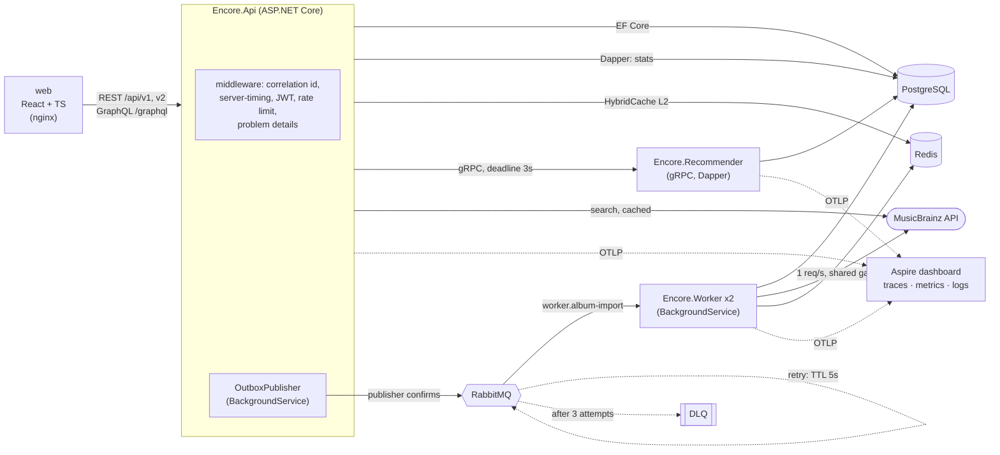

# Encore

An album diary: search MusicBrainz, add albums to your library, rate them, see listening stats and get recommendations from what other listeners added.

Built as a compact, production-shaped backend in **C# / .NET 10**, with a **React + TypeScript** frontend. The domain is small on purpose; the engineering around it is the point: REST and GraphQL APIs, a gRPC internal service, a RabbitMQ worker fed by a transactional outbox, EF Core and Dapper on PostgreSQL, OpenTelemetry tracing across process boundaries, and tests against real containers.

## Architecture



**Write path for "add album":** `POST /api/v1/library` saves the album (status `Pending`), the library entry and an outbox row in **one transaction**, and returns `202 Accepted` with a `Location` to poll. The outbox publisher sends the event to RabbitMQ. A worker fetches the tracklist and tags from MusicBrainz and marks the album `Enriched`. One distributed trace covers the whole path.

## Run it

Requirements: Docker. For local development also the .NET 10 SDK and Node 24 + pnpm.

```bash
docker compose up --build
```

| What | URL |
|---|---|
| App | http://localhost:3000 |
| REST API docs (Scalar, OpenAPI v1 + v2) | http://localhost:8080/scalar |
| GraphQL IDE (Nitro) | http://localhost:8080/graphql |
| Traces, metrics, structured logs | http://localhost:18888 |
| RabbitMQ management (guest/guest) | http://localhost:15672 |

Ports clash with something else on your machine? Copy `.env.example` to `.env` and change them.

### Local development

```bash
docker compose up -d postgres rabbitmq redis aspire-dashboard
dotnet run --project src/Encore.Api           # http://localhost:5080
dotnet run --project src/Encore.Worker
dotnet run --project src/Encore.Recommender   # http://localhost:5081 (HTTP/2)
cd web && pnpm install && pnpm dev            # http://localhost:5173
```

Set `OTEL_EXPORTER_OTLP_ENDPOINT=http://localhost:4317` to send local telemetry to the dashboard.

### Tests

```bash
dotnet test             # 26 unit + 14 integration (Testcontainers: real Postgres and RabbitMQ)
cd web && pnpm test     # component tests (Vitest + Testing Library)
```

## API at a glance

| Method | Path | Notes |
|---|---|---|
| POST | `/api/v1/auth/token` | Demo login, returns a JWT |
| GET | `/api/v1/search/albums?q=` | MusicBrainz search; cached, rate limited per user |
| GET | `/api/v1/library` | v1: full array |
| GET | `/api/v2/library?limit=&cursor=` | v2: keyset pagination |
| POST | `/api/v1/library` | `{ mbId }` → `202 Accepted` + `Location` |
| GET | `/api/v1/library/{albumId}` | Poll import status |
| PUT | `/api/v1/library/{albumId}/rating` | `{ rating: 1-5, review? }` |
| DELETE | `/api/v1/library/{albumId}` | |
| GET | `/api/v1/stats` | Dapper, 3 result sets in one round trip |
| GET | `/api/v1/recommendations` | Calls the gRPC recommender; 503 if it is down |
| POST | `/graphql` | `myLibrary`, `album(id)`, `albumsByTag(tag)` with DataLoaders |
| GET | `/health/live`, `/health/ready` | Liveness vs readiness |

Errors use RFC 9457 problem details with a `traceId`.

## Repository layout

```
src/
  Encore.Core          domain model, EF Core DbContext + migrations, RabbitMQ plumbing,
                       MusicBrainz client, OpenTelemetry setup (shared by all services)
  Encore.Api           REST + GraphQL, middleware, outbox publisher
  Encore.Worker        RabbitMQ consumer: enrichment, retries, DLQ, idempotency
  Encore.Recommender   gRPC service, one SQL query
protos/                gRPC contract (shared by client and server)
tests/
  Encore.UnitTests
  Encore.IntegrationTests
web/                   React + TypeScript (Vite), served by nginx in compose
docs/architecture.md   design decisions and their trade-offs
```

## Design decisions

The short version is below. [docs/architecture.md](docs/architecture.md) explains each one and what I would change at larger scale.

- **Transactional outbox** instead of publishing inside the request: no lost events, no distributed transaction.
- **At-least-once delivery + idempotent consumer** (`processed_messages` written in the same transaction as the change).
- **Delayed retries through a TTL queue, then a dead-letter queue**: transient MusicBrainz failures heal by themselves, poison messages stop looping.
- **EF Core for writes, Dapper for reporting SQL**: each tool where it is strongest.
- **Optimistic concurrency** with Postgres `xmin`; **unique indexes + retry** for concurrent inserts.
- **Keyset pagination** in v2, a breaking change shipped as a new API version.
- **Rate limit for MusicBrainz in Redis**, because the limit is per IP and the API and every worker share that IP.
- **HybridCache** (memory + Redis) with stampede protection for search results.
- **GraphQL DataLoaders** so nested queries cost a fixed number of SQL statements.
- **gRPC with deadlines** for the internal recommender, and graceful degradation when it is down.

## How AI was used

I used Claude Code as a pair programmer: scaffolding, reading library APIs I had not used before (RabbitMQ.Client 7, Asp.Versioning 10), and writing tests. Every bug listed in [docs/architecture.md](docs/architecture.md#bugs-found-while-building) was caught by a test or a manual run, then fixed and explained.
